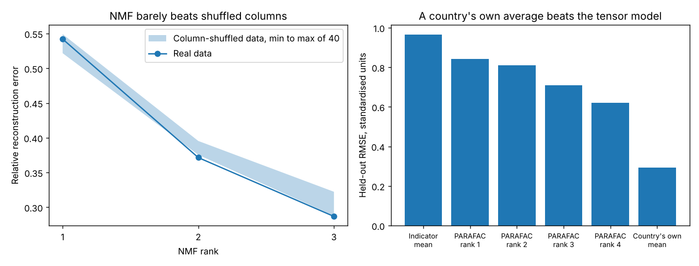
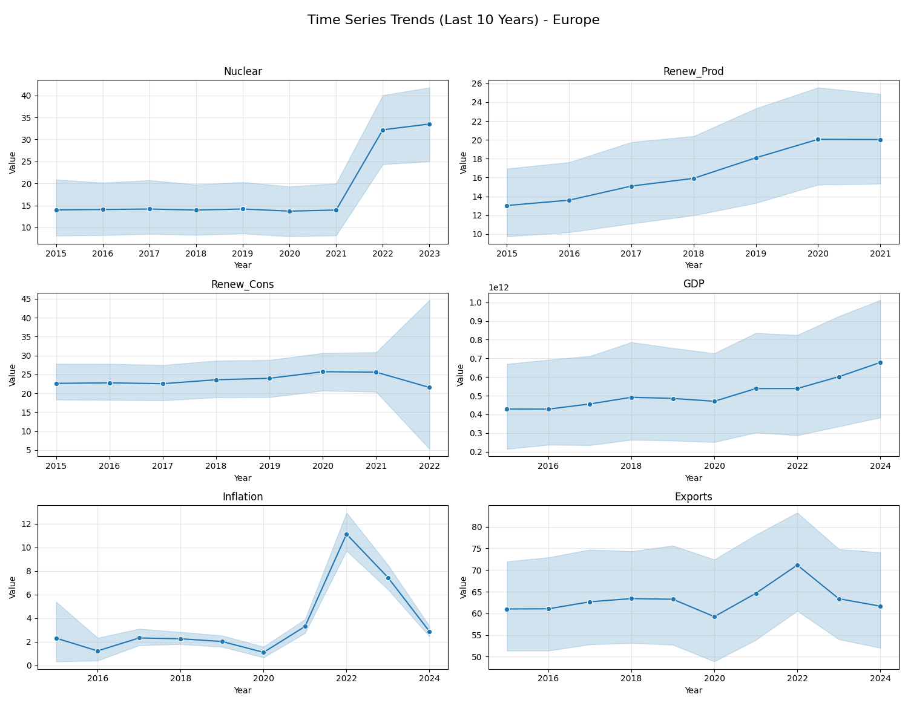

# World Bank Indicators: Statistical & Multivariate Analysis

[](https://github.com/dbechrakis/world-bank-indicators-analysis/actions/workflows/evidence.yml)

A data analytics case study combining **World Bank indicators, statistical analysis, SQL, visualization, outlier detection, and unsupervised learning** to explore economic and energy patterns across countries and regions.

## Executive summary

The analysis works with six indicators:

- GDP
- Inflation
- Exports (% of GDP)
- Nuclear electricity production (% of total)
- Renewable electricity production, excluding hydroelectric (% of total)
- Renewable energy consumption (% of total final energy)

The workflow transforms heterogeneous country-level data into an analytical structure and then applies statistical and multivariate methods to investigate regional patterns, relationships, anomalies, and latent structure.

## Key findings

Everything below is descriptive. It uses ten-year country means, and GDP is current US$, so it measures economy size and not income per person. Intervals are 95% bootstrap intervals over countries. [All numbers](outputs/structure_findings.json) · [Method code](wb_indicators/structure.py).

**1. Nuclear power is a threshold, not a gradient.** Only 32 of 203 countries (16%) produce any nuclear electricity, and 18 of them are in Europe. Economy size separates producers from non-producers well (AUC 0.91, CI 0.86 to 0.95). Among the 32 producers, larger economies have a lower nuclear share (Spearman −0.38, CI −0.63 to −0.03). The highest shares sit in mid-sized economies: France 69%, Slovakia 56%, Ukraine 53%, Hungary 47%, Belgium 44%.

**2. Renewable share of final energy rises and then falls with economy size.** Median share by GDP quintile, smallest to largest: 11.9%, 25.7%, 30.5%, 23.7%, 13.2%. A single rank correlation misses this (Spearman −0.04, CI −0.17 to 0.10, n=207).

**3. NMF and PARAFAC find little shared structure, and the earlier reading of them as latent groups is not supported.** The checks are in [`structure_analysis.py`](scripts/structure_analysis.py).



- *The components are stable under resampling and unstable under preprocessing.* Rank-2 NMF returns the same components from 30 random starts (cosine at least 0.9999) and across 200 bootstrap resamples of countries (5th percentile 0.989). Changing how the data are scaled moves the second component a lot: log GDP and log inflation give cosine 0.63, percentile ranks 0.86 and complete cases only 0.66. The first component moves less (0.90, 0.74, 0.96). Under the original min-max scaling GDP is below 0.01 for 77% of countries, so it cannot carry weight in the factors.
- *NMF barely beats the same columns shuffled.* Relative error of the real data against 40 column-shuffled copies: rank 2 gives 0.371 against 0.388 on average (best shuffle 0.375). Rank 3 gives 0.287 against 0.309 (best 0.288). Rank 1 is slightly worse than the shuffled average (0.542 against 0.535). Error falls steadily from rank 1 to 5 (0.54, 0.37, 0.29, 0.21, 0.13) with no elbow that would point to a rank.
- *A country's own average beats the tensor model.* Holding out 10% of observed cells (1,038), standardised RMSE is 0.97 for the indicator mean and 0.84, 0.81, 0.71, 0.62 for PARAFAC ranks 1 to 4. Rank 5 is unstable (1.08, from 0.77 to 1.61 across seeds), and rank 3 ranges from 0.67 to 0.77. Predicting each cell from that country's other years gives 0.29, far better than any rank.
- *Reading.* The panel is dominated by persistent country levels. Every extra component fits some of that persistence, which is why error keeps falling, but it does not reveal groups of indicators that move together beyond what each indicator's own distribution implies.

Limits: ten-year means hide trends. The tensor has 78% of cells observed and indicators end in different years. The held-out check uses one random 10% split. No causal claim is made.

## Analytical questions

- How do economic and energy indicators differ across regions?
- Which observations behave as statistical outliers?
- How are the selected indicators correlated?
- Can unsupervised methods reveal latent indicator groupings?
- How can the cleaned analytical dataset support SQL-based exploration?

## Workflow

```text
World Bank data
      ↓
Cleaning & standardization
      ↓
Long-format analytical dataset
      ↓
EDA & regional aggregation
      ↓
Outlier detection
      ↓
Correlation / covariance analysis
      ↓
NMF & PARAFAC
      ↓
SQLite + SQL analysis
```

## Methods

### Data preparation

- Standardize country names
- Map countries to continents
- Reshape wide-format indicator files into analytical long format
- Export cleaned datasets for downstream analysis

### Statistical analysis

- Regional aggregation
- Decade comparisons
- Correlation and covariance matrices
- Regional Z-score analysis
- IQR-based outlier detection

### Multivariate analysis

- **NMF** for latent indicator structure
- **PARAFAC tensor decomposition** for country × year × indicator patterns

### SQL analytics

Cleaned analytical data is loaded into **SQLite** to support regional and country-level queries.

## Repository structure

```text
world-bank-indicators-analysis/
├── README.md
├── wb_indicators/
│   ├── prepare.py              # Load, standardise countries, reshape to long format
│   ├── outliers.py             # Z-scores and IQR fences (no plotting, no I/O)
│   └── structure.py            # Stability, shuffled-null and held-out checks for NMF and PARAFAC
├── scripts/
│   ├── world_bank_analysis.py  # Outliers, plots, NMF and PARAFAC pipeline
│   └── structure_analysis.py   # Checks that test whether that structure is real
├── sql/
│   └── build_database.py
├── tests/                      # Data preparation, outlier, structure-check and database tests
└── data/
    └── raw/
        ├── nuclear_production.csv
        ├── renewable_production.csv
        ├── renewable_consumption.csv
        ├── gdp.csv
        ├── inflation.csv
        └── exports.csv
```

## Reproduction and verified coverage

```bash
pip install -r requirements.txt
python scripts/world_bank_analysis.py
python sql/build_database.py
python scripts/structure_analysis.py   # about 15 seconds, writes outputs/structure_findings.json
```

Run the tests with `python -m unittest discover -s tests -v`.

Both scripts were executed against all six committed source files in this review. The database contains **10095 country-indicator-year observations**. [Coverage by indicator](outputs/indicator_coverage.csv) · [Database checks](outputs/validation.json).

The database window is the last ten calendar years relative to the newest observation in the combined data. Individual indicators have different latest years and missingness. This is not a balanced panel. Country averages are unweighted and do not estimate population-weighted regional outcomes.

NMF in `world_bank_analysis.py` uses within-indicator median imputation before min-max scaling. PARAFAC masks missing observations rather than treating them as zero. Key finding 3 tests both: their components are stable under resampling, depend on the scaling choice, and add little over each country's own average.



## Outputs

The analysis generates cleaned datasets, visualizations, analytical outputs, and a project log. Generated artifacts are kept separate from the source analysis code.

## Tech stack

**Python · pandas · NumPy · Matplotlib · scikit-learn · TensorLy · SQLite · SQL · pycountry**

## Interpretation note

The project is intentionally analytical rather than causal. Correlations, regional differences, and latent structures are treated as descriptive evidence and should not be interpreted as causal relationships without additional identification and validation.

## Context

Portfolio data analytics case study developed during an MSc Data Science programme at **The American College of Greece**.

## Author

**Dimitris Bechrakis**  
Business & Data Analyst | M.Sc. Data Science

## Licensing

See [licensing scope](LICENSING.md) for the MIT-licensed verification code and the separately governed project materials.
